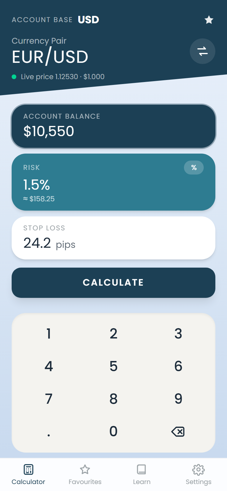
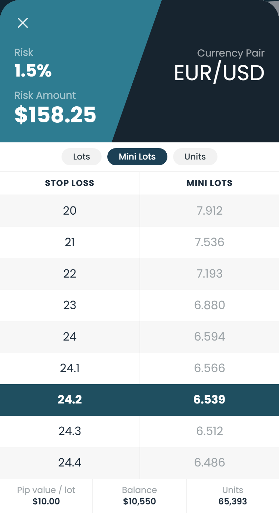
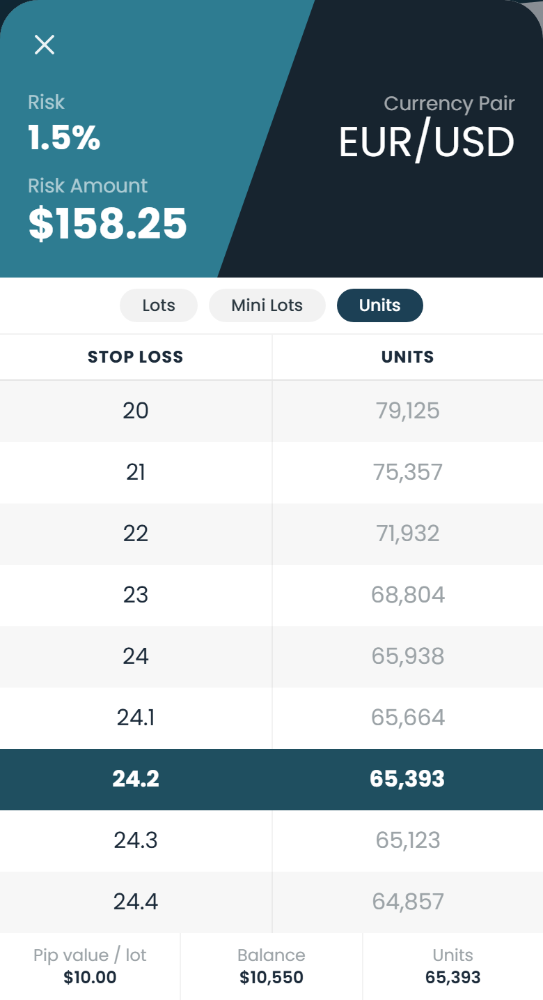
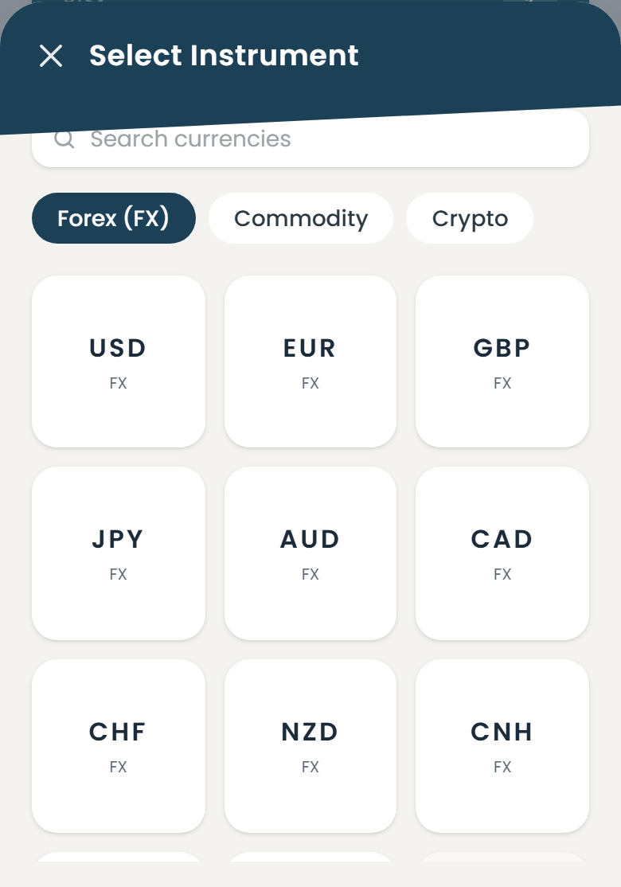
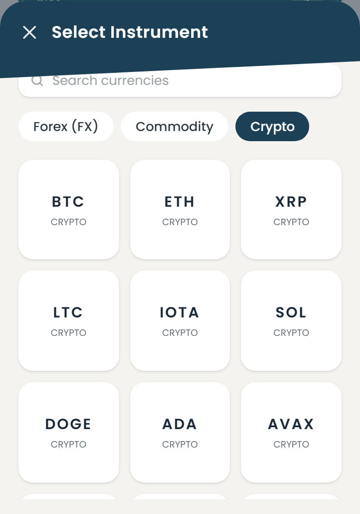
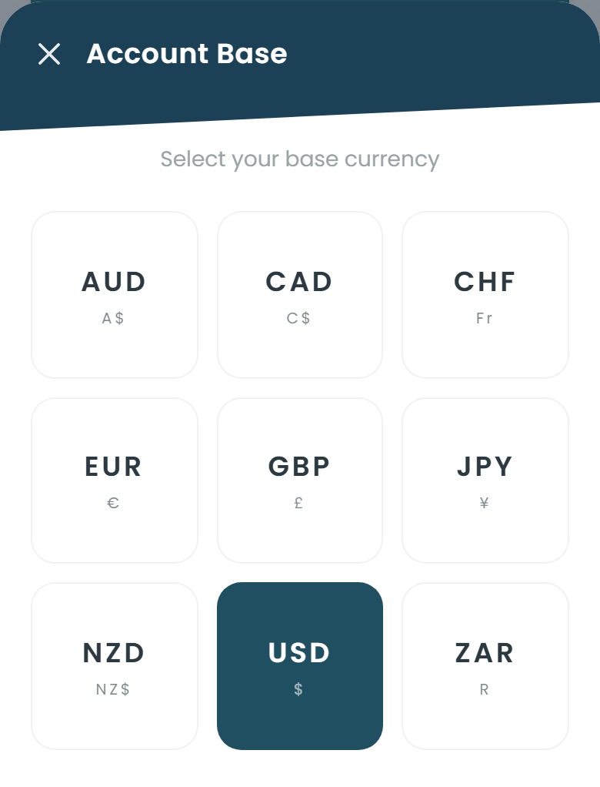

<div align="center">

# STINU — Position Size Calculator · Web Replica

**A pixel- and math-faithful web rebuild of the Android app _"Stinu — Position Size Calculator"_ (v5.7.3),
reverse-engineered from the APK and verified byte-for-byte against the original's own output.**

[](https://nextjs.org)
[](https://react.dev)
[](https://www.typescriptlang.org)
[](https://tailwindcss.com)
[](#-verification)

</div>

---

## What this is

The original **STINU** is a forex position-size calculator: you enter your account balance, your risk,
and your stop-loss distance, and it tells you exactly how many **lots / mini lots / units** to trade —
then lets you *nudge the stop-loss and watch the size change live* without re-entering anything.

This repository is a **functional replica** of that app as a **Next.js web app**. The goal was not a
lookalike mockup — the calculator reproduces the original's results **exactly**, and the UI is rebuilt
from the app's real screens.

> **Scope:** calculator + UI. No paywall, no Firebase, no accounts. Live FX rates come from free,
> keyless public feeds.

## Screenshots

| Home calculator | Result table (Mini Lots) | Result table (Units) |
|:---:|:---:|:---:|
|  |  |  |

| Instrument picker — Forex | Instrument picker — Crypto | Account base currency |
|:---:|:---:|:---:|
|  |  |  |

## Features

- **Exact position sizing** — risk in **%** or **currency**, stop-loss in pips, output in **Lots / Mini Lots / Units**.
- **The signature "nudge" table** — coarse stop-loss rows with fine 0.1 steps around your value, so you can
  adjust risk *without re-entering your details*. Your current row is highlighted.
- **Live prices** — free, keyless feeds (Frankfurter → open.er-api → bundled offline fallback), refreshed every 60s.
- **Three instrument classes** — Forex (majors + exotics), Commodities (Gold / Silver / WTI), and Crypto.
- **Custom on-screen keypad**, slanted navy header, staircase input cards, and a 4-tab bar
  (Calculator · Favourites · Learn · Settings) — all matching the original layout.
- **Account base currency** selector (AUD CAD CHF EUR GBP JPY NZD USD ZAR).
- **No backend** — it's a static app; prices are fetched client-side.

## Verification

The whole point of this project: **the math is confirmed against the original, not approximated.**

The APK was decompiled (`dex2jar` → `CFR`) and the core is `k6/l0.java`, method `P()`. Its arithmetic is
**algebraically identical** to what this clone implements. Independently, the replica was validated
against the app's own store screenshots — every value reproduces **exactly**:

> EUR/USD · balance **$10,550** · risk **1.5% → $158.25**

| STOP LOSS | MINI LOTS | | STOP LOSS | MINI LOTS |
|:---:|:---:|:---:|:---:|:---:|
| 20 | 7.912 | | 24 | 6.594 |
| 21 | 7.536 | | 24.1 | 6.566 |
| 22 | 7.193 | | **24.2** | **6.539** ← highlighted |
| 23 | 6.880 | | 24.3 | 6.512 |
| | | | 24.4 | 6.486 |

Footer: **Pip value / lot $10.00 · Balance $10,550 · Units 65,393**.

`verify2.mjs` drives a real headless Chromium, opens the result sheet, and asserts this exact table
string, the highlighted row, the footer, and all three unit modes — plus **zero console errors**:

```bash
npm run build && npm run start -- -p 4173
node verify2.mjs        # exits 0 only on an exact match
```

## The formula

```
riskAmount      = balance × riskPercent / 100      (or the entered currency amount)
pipValuePerLot  = pipSize × contractSize × quoteToAccount
lots            = riskAmount / (stopPips × pipValuePerLot)
miniLots        = lots × 10
units           = lots × contractSize
```

For EUR/USD on a USD account: `pipValuePerLot = 0.0001 × 100,000 × 1 = $10.00`.
Formatting uses `toFixed` semantics so `158.25 / 20 → "7.912"` — matching the original's rounding.

## What's in the app

### Calculator
The home screen. Three staircase cards — **Account Balance** (navy), **Risk** (teal, with a %/amount
toggle), **Stop Loss** (white) — a **CALCULATE** button, and a custom numeric keypad. The header shows
the account base, the currency pair (tap to change, tap ⇄ to swap), the live price, and a favourite star.

### Result table
Two-tone diagonal header (Risk / Risk Amount / Currency Pair), a **Lots · Mini Lots · Units** toggle,
the stop-loss → size table with the active row highlighted, and a footer with pip value, balance and units.

### Instrument picker
Three tabs — **Forex (FX)**, **Commodity**, **Crypto** — over a searchable grid:

- **Forex** (23): AUD CAD CHF EUR GBP JPY NZD USD **CNH** **CZK** DKK HUF ILS HKD KRW MXN NOK PLN RUB SEK SGD TRY ZAR
- **Commodities**: WTI (Crude Oil), XAU (Gold, contract 100), XAG (Silver, contract 5000)
- **Crypto** (19): BTC ETH XRP LTC IOTA SOL DOGE ADA AVAX DAI USDC LN SHIB FDUSD BNB TRX SUI BCH XLM

*(The instrument lists and contract sizes were read from the decompiled binary — not guessed.)*

### Account base
Pick the currency your account is denominated in; risk and pip value are converted accordingly.

### Favourites · Learn · Settings
Saved pairs, the app's tutorial copy (lots vs mini lots, gold/silver contract sizes, pips explained),
and settings for base currency, risk mode, result units and a reset.

## Tech stack

| Layer | Choice |
|---|---|
| Framework | Next.js 16 (App Router) |
| UI | React 19 + Tailwind CSS 4 |
| Language | TypeScript |
| Font | Poppins (via `next/font`) |
| Prices | Frankfurter → open.er-api → static fallback (no key) |
| Tests | Playwright (headless Chromium) |

## Getting started

```bash
npm install
npm run dev        # http://localhost:3000
```

Production build:

```bash
npm run build
npm run start
```

Verify the calculator against the reference table:

```bash
node verify2.mjs
```

## Project layout

```
app/
  page.tsx          Home calculator (header, cards, keypad, tabs)
  layout.tsx        Root layout + font
  globals.css       Theme (colors sampled from the app)
components/
  Keypad.tsx        Custom numeric keypad
  PairPicker.tsx    Instrument picker (FX / Commodity / Crypto tabs)
  BaseCurrencySheet.tsx
  ResultSheet.tsx   Result screen: diagonal header + stop-loss table
  icons.tsx         Line icons
lib/
  calc.ts           Position-size engine + table builder + formatter
  instruments.ts    Instrument model (pip sizes, contract sizes)
  prices.ts         Live FX feeds + offline fallback
verify2.mjs         Byte-exact verification harness
```

## Notes & honest limitations

- **The APK's embedded secrets are not reproduced.** The original embeds a Firebase config and vendor
  price-feed credentials (TrueFX / currencydatafeed.com). None of those values are used here — this
  clone uses independent free feeds.
- **Crypto is modelled with the FX formula** (contract size 1) as an approximation. The original routes
  crypto through a separate price-distance branch (`k6/l0.java`); that branch is not yet replicated, so
  the app **blocks** crypto calculation rather than returning a wrong number.
- **Commodities** have no rate in the FX feed, so they are likewise blocked with a clear message until a
  commodity price source is added.
- This is an **independent reimplementation** of the app's behavior and appearance — not a copy of its
  code or assets. All trademarks belong to their owners.

---

<div align="center"><sub>Reverse-engineered and rebuilt with the Hermes Agent · educational use</sub></div>
